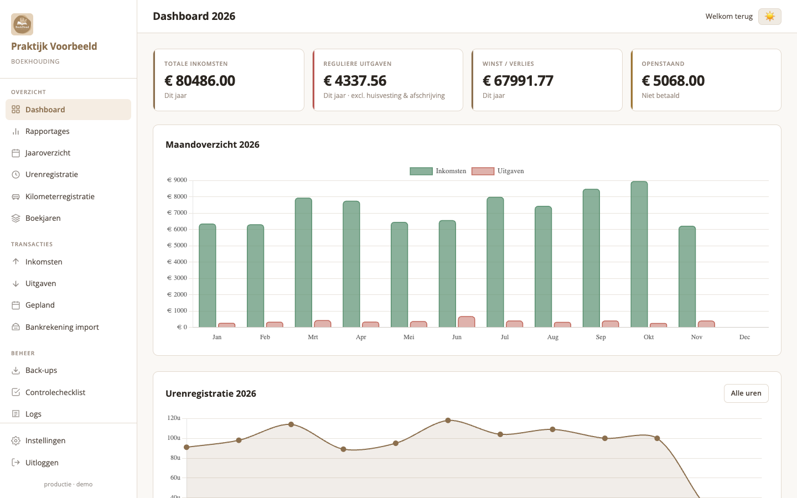
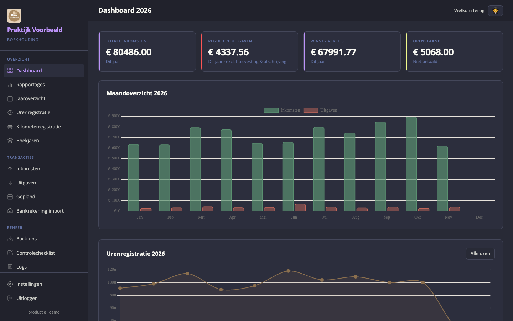
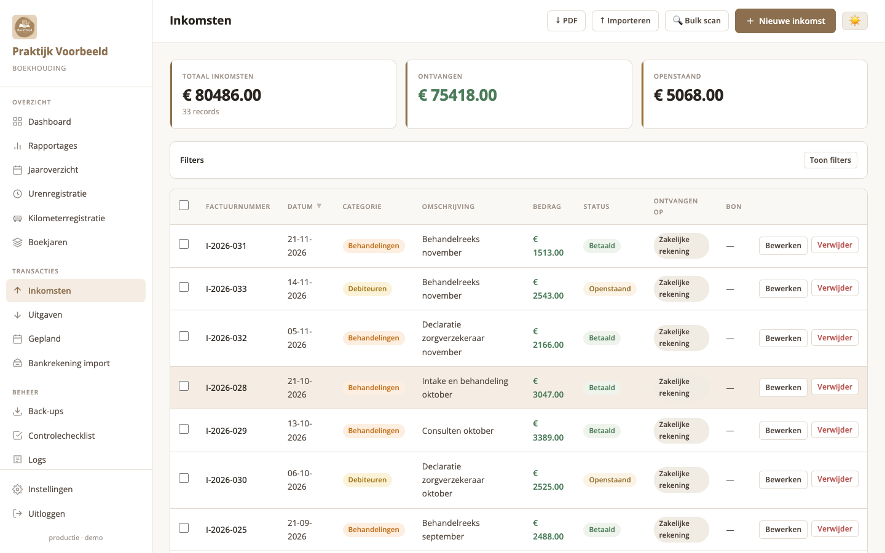
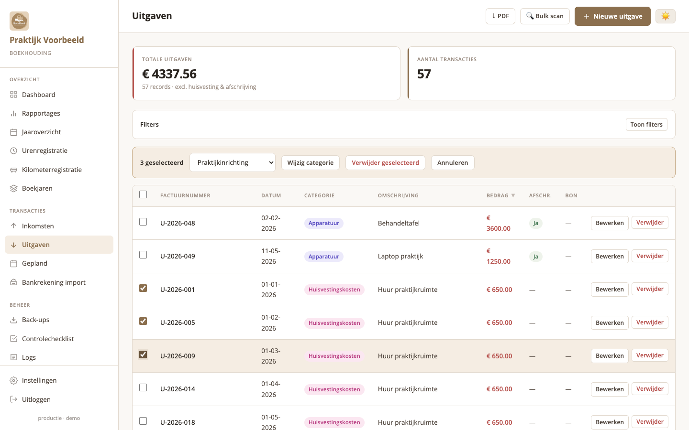
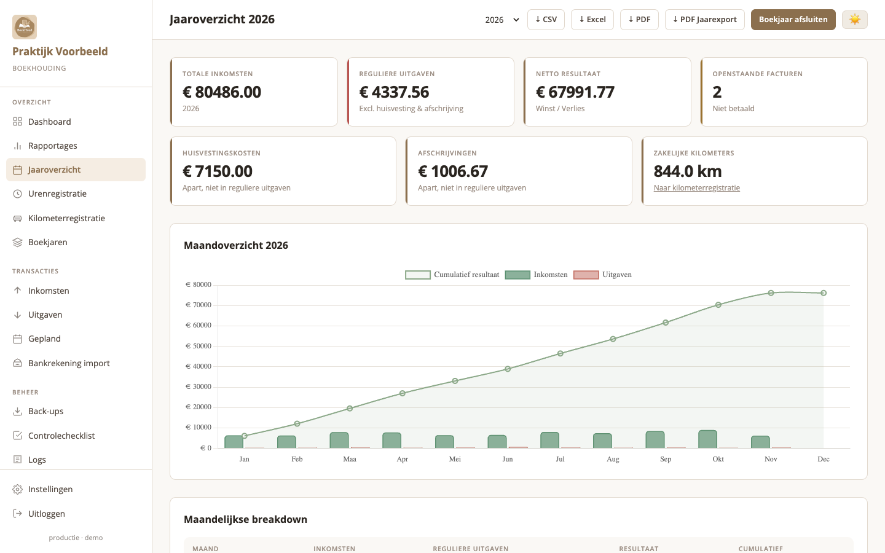
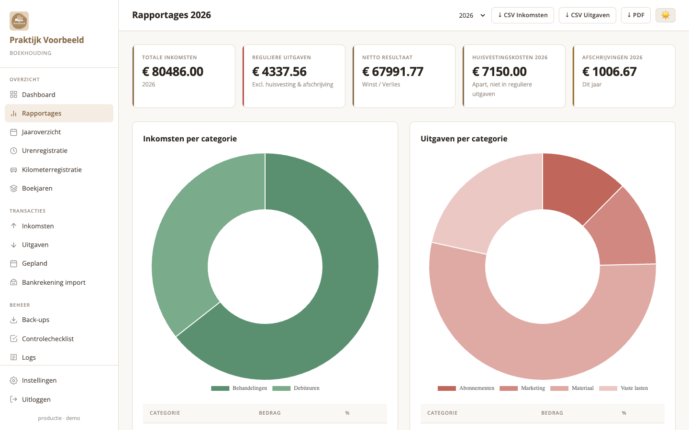
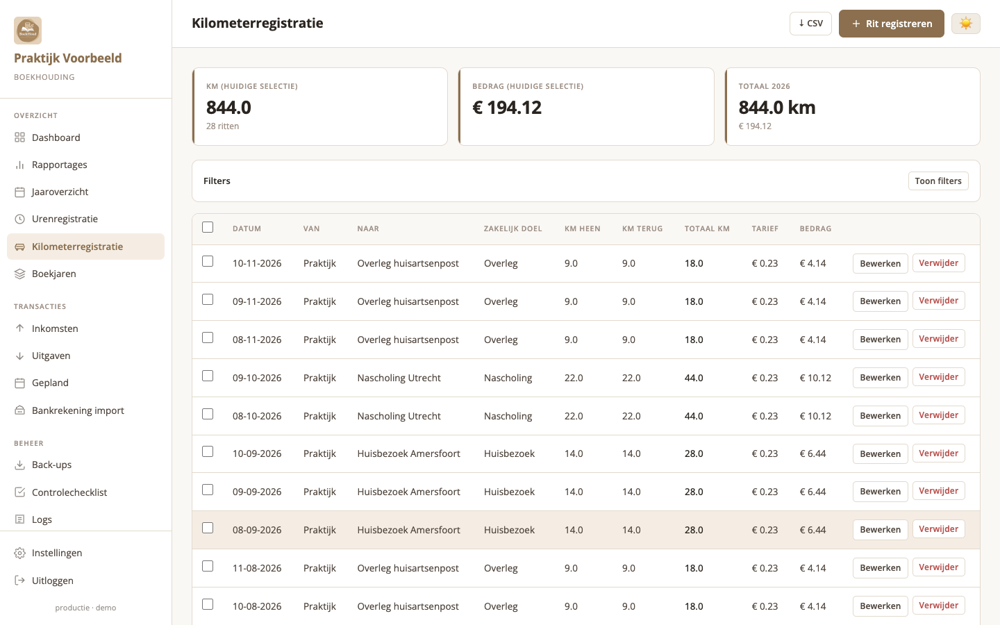
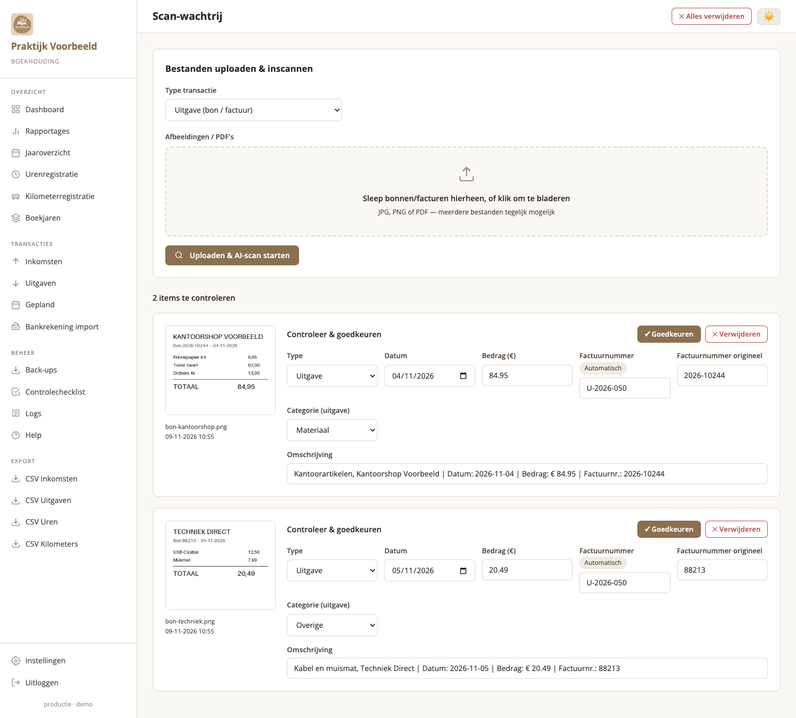
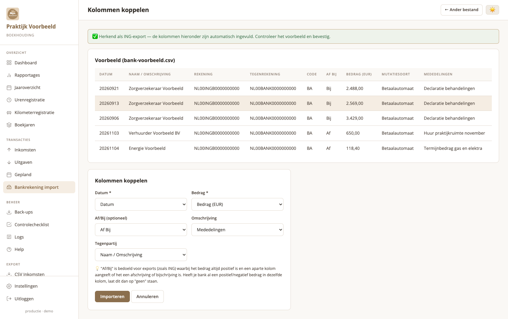
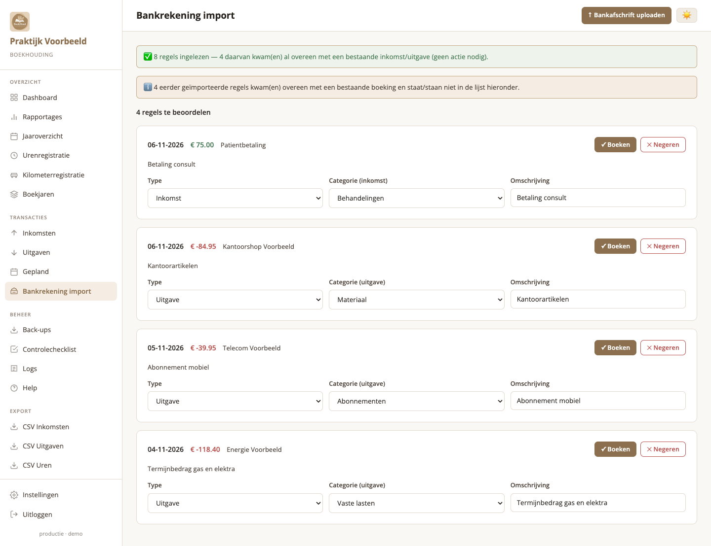

# 📒 Boekhoud App

Een eenvoudige, lichtgewicht en self-hosted boekhoudapplicatie voor kleine praktijken en zelfstandigen.

## ✨ Functies

- **Inkomstenbeheer** — Facturen bijhouden met status (betaald / onbetaald)
- **Uitgavenbeheer** — Kosten per categorie registreren
- **Bonnen uploaden** — PDF, JPG, PNG — automatisch opgeslagen per categorie
- **AI-bonverwerking** — Automatisch uitlezen via OpenAI of lokale Ollama LLM
- **Afschrijvingen** — Investeringen over 5 jaar afschrijven
- **Geplande uitgaven** — Toekomstige uitgaven en notities bijhouden
- **Dashboard** — Overzicht met grafieken en statistieken
- **Rapportages** — Per jaar, per categorie, afschrijvingsoverzicht
- **CSV export** — Inkomsten en uitgaven exporteren
- **Database backup** — Met één klik een backup aanmaken
- **Docker** — Volledig geconfigureerd voor Docker Compose

## 📸 Screenshots

Alle schermafbeeldingen komen uit een demo-omgeving met volledig verzonnen gegevens.

| | |
|---|---|
|  |  |
| **Dashboard** | **Dashboard — 16 thema's, hier Dracula** |
|  |  |
| **Inkomsten** | **Uitgaven met bulkselectie** |
|  |  |
| **Jaaroverzicht** | **Rapportages** |
|  |  |
| **Kilometerregistratie** | **Bulk scan van bonnen en facturen** |
|  |  |
| **Bankrekening import — kolommen koppelen** | **Bankrekening import — regels beoordelen** |

## 🚀 Installatie

### Vereisten
- Docker
- Docker Compose

### Stap 1 — Kloon of download het project

```bash
git clone <repo-url> boekhoud-app
cd boekhoud-app
```

### Stap 2 — Configureer omgevingsvariabelen (optioneel)

Maak een `.env` bestand aan:

```env
# Verplicht: verander dit naar een lange willekeurige string
SECRET_KEY=vervang-dit-met-een-veilig-wachtwoord-123abc

# Optioneel: voor AI-bonverwerking via OpenAI
OPENAI_API_KEY=sk-...

# Optioneel: voor lokale AI via Ollama
OLLAMA_BASE_URL=http://localhost:11434
```

### Stap 3 — Start de applicatie

```bash
docker-compose up -d
```

### Stap 4 — Open de app

Ga naar: **http://localhost:8000**

**Standaard inloggegevens:**
- Gebruikersnaam: `admin`
- Wachtwoord: `admin123`

> ⚠️ **Wijzig het wachtwoord direct na de eerste login!**

---

## 📁 Mappenstructuur

```
boekhoud-app/
├── main.py                    # FastAPI applicatie
├── requirements.txt           # Python packages
├── Dockerfile                 # Docker image definitie
├── docker-compose.yml         # Docker Compose configuratie
├── backend/
│   ├── models/
│   │   ├── models.py          # Database modellen
│   │   └── database.py        # Database verbinding & init
│   ├── routers/
│   │   ├── auth.py            # Inloggen / uitloggen
│   │   ├── incomes.py         # Inkomstenbeheer
│   │   ├── expenses.py        # Uitgavenbeheer
│   │   ├── dashboard.py       # Dashboard & rapportages
│   │   └── misc.py            # OCR, instellingen, backup, gepland
│   ├── services/
│   │   ├── auth.py            # Authenticatie helpers
│   │   ├── ocr.py             # OCR & AI-verwerking
│   │   └── files.py           # Bestandsbeheer
│   └── templates/             # Jinja2 HTML templates
├── data/                      # SQLite database (persistent)
├── uploads/                   # Geüploade bestanden (persistent)
│   ├── inkomsten/behandelingen/
│   ├── uitgaven/praktijkinrichting/
│   ├── uitgaven/vaste_lasten/
│   └── ...
└── backups/                   # Database backups
```

---

## 🤖 AI-bonverwerking configureren

### Optie 1: OpenAI (cloud)

Voeg toe aan `.env`:
```env
OPENAI_API_KEY=sk-jouw-api-sleutel
```

### Optie 2: Ollama (lokaal, gratis)

1. Installeer [Ollama](https://ollama.ai)
2. Haal het model op: `ollama pull llama3.2`
3. Voeg toe aan `.env`:
```env
OLLAMA_BASE_URL=http://host.docker.internal:11434
```

Als geen AI geconfigureerd is, wordt Tesseract OCR gebruikt voor tekstextractie.

---

## 💾 Backup & Herstel

### Backup aanmaken
Via de app: Instellingen → "Backup aanmaken"

Of handmatig:
```bash
cp data/boekhoud.db backups/boekhoud_$(date +%Y%m%d).db
```

### Backup herstellen
```bash
docker-compose down
cp backups/boekhoud_20260101.db data/boekhoud.db
docker-compose up -d
```

---

## 🔒 Beveiliging

- Wachtwoorden worden gehashed met bcrypt
- Sessies zijn beveiligd met een HMAC-gesigneerde cookie
- Bestandsuploads zijn beperkt tot PDF, JPG en PNG
- Maximale bestandsgrootte: 10MB
- Input wordt gevalideerd voor opslag

---

## 🛠 Onderhoud

### Logs bekijken
```bash
docker-compose logs -f app
```

### App herstarten
```bash
docker-compose restart app
```

### Updaten
```bash
docker-compose down
git pull
docker-compose up -d --build
```

---

## 📊 Categorieën

### Inkomsten
- Behandelingen

### Uitgaven
- Praktijkinrichting
- Vaste lasten
- Abonnementen
- Materiaal
- Materieel
- Marketing
- Reiskosten

---

*Gebouwd met FastAPI, SQLite, Jinja2 en Tailwind-stijlen.*
